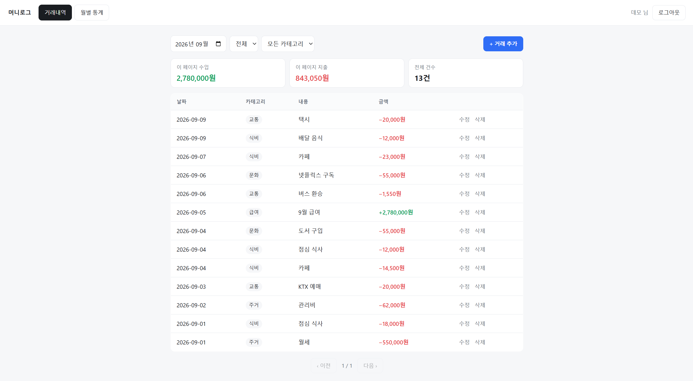
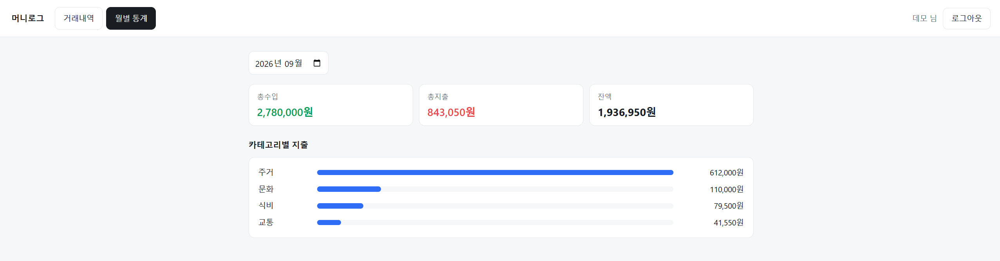
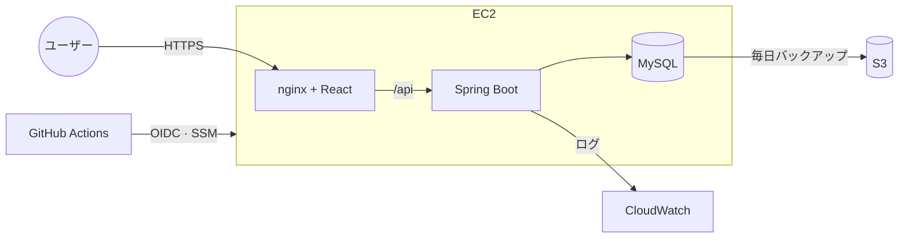

# マネーログ (MoneyLog)

[](https://github.com/DANIELSUNWOO/moneylog/actions/workflows/ci-backend.yml)     

[한국어](README.md) · **日本語**

収入・支出を記録し、カテゴリ別・月別の統計を確認できる家計簿ウェブサービスです。

**[サービスを開く](https://sunwoomoneylog.duckdns.org)** · デモアカウント `demo@example.com` / `demo1234` · [API ドキュメント](https://sunwoomoneylog.duckdns.org/swagger-ui.html)

| 取引履歴 | 月別統計 |
|---|---|
|  |  |

## 作った理由

日本でキャリアを始める前に、資金を計画的に貯めたいと思って作りました。何にいくら使っているか、今月の残高はいくらかを一つの画面で確認できることを目標にしました。私のように留学や海外就職を準備している人も使えるよう、アカウントごとに家計簿を分け、他の人の履歴は見られないようにしています。

## 主な機能

- 会員登録・ログイン（JWT）
- 収入・支出の登録、編集、削除とカテゴリ管理
- 月・収入／支出・カテゴリでの絞り込みとページング
- 月別統計：総収入、総支出、残高、カテゴリ別の支出の割合
- 他のユーザーのデータへのアクセスを拒否（統合テスト 17 件で確認）

## 技術スタック

| 領域 | 使用技術 |
|---|---|
| Backend | Java 21, Spring Boot 3.x, Spring Data JPA, Spring Security, JWT, MySQL 8 |
| Frontend | React 19, Vite |
| Infra | Docker Compose, GitHub Actions, AWS (EC2, S3, CloudWatch, IAM, SSM), nginx, Let's Encrypt, Terraform |

## 構成図



## デプロイと運用で試したこと

機能を完成させた後は、ブートキャンプで学んだクラウドを実際に使ってみることに時間を使いました。クラウドは事前知識がほとんどなかったため、基本的な機能から一つずつ試しました。

- **CI/CD**：PR でビルド・テスト、main へのマージで EC2 に自動デプロイ。フロントエンドとバックエンドのワークフローを分離（[ドキュメント](docs/cicd-pipeline-reference.md)）
- **HTTPS・ドメイン**：Let's Encrypt の証明書と自動更新、DuckDNS のドメイン
- **SSH なしのデプロイ**：SSH キーの代わりに OIDC で一時的な権限を受け取り、SSM でデプロイ。22 番ポートを閉鎖（[トラブルシューティング](docs/troubleshooting-oidc-ssm-deploy.md)）
- **ロールバック・バックアップの練習**：前のバージョンに戻す、テーブルを削除して S3 のバックアップから復旧する（[ロールバック](docs/rollback-drill.md) · [バックアップ](docs/backup-restore-drill.md)）
- **モニタリング**：CloudWatch でログとメモリの指標を収集し、メモリが 85% を超えるとメールで通知（[ドキュメント](docs/cloudwatch-setup.md)）
- **Terraform**：コンソールで作った AWS リソースをコードに移してみた。初めて使ったツールで、まだ慣れていない（[ドキュメント](docs/terraform-import.md)）

AWS は無料枠の範囲内だけで使い、実際の請求額は 0 円です。

## トラブルシューティング

| 問題 | 原因と解決 |
|---|---|
| OIDC 認証が 6 回続けて拒否された | 公式ドキュメントの例どおりに設定していたが、GitHub が実際に送っている値をログに出すと、リポジトリ名の後ろに数字の ID が付いた形式だった。実際の値に合わせて解決 |
| SSM でのデプロイコマンドが失敗した | SSM は root でコマンドを実行するが、docker compose が ec2-user のフォルダにしかインストールされていなかった。共通のパスに移して解決 |
| ドメイン変更後に会員登録ができなくなった | CORS の許可リストに新しいドメインがなかった（[ドキュメント](docs/troubleshooting-cors-signup.md)） |
| README のとおりにローカルで動かなかった | プロキシ・証明書・ポート衝突の三つが原因だった（[ドキュメント](docs/troubleshooting-local-docker-run.md)） |

## 学んだこと

- 設定を変え続けるより、実際にやり取りされている値を直接確認するほうが、原因を見つける一番の近道でした。
- 自動化すると、コマンドを実行するユーザーや権限が変わることがあると学びました。
- バックアップは作っておくだけでは不十分で、実際に復旧してみて初めて使えるかどうかが分かりました。

## AI の活用

Claude と一緒に開発しました。機能の構成や画面の配置は私が決め、実装とテスト用のダミーデータ作成は Claude に任せました。完成した機能は自分で動かして確認し、git・Docker・AWS のコマンドは自分で実行しました。

## 課題と今後の予定

- サーバー内の設定（証明書の更新、DuckDNS の IP 更新、DB バックアップスクリプト）はまだ手作業で入れた状態のため、サーバーを作り直すと再設定が必要です。
- Terraform をきちんと理解し、上の設定もコードに移す予定です。
- 予算設定、統計グラフ、CSV エクスポートを追加してみたいです。

## ローカルでの実行

```bash
git clone https://github.com/DANIELSUNWOO/moneylog.git
cd moneylog
cp .env.example .env   # DB_PASSWORD, JWT_SECRET などを設定
docker compose up -d --build
```

- フロントエンド: http://localhost
- Swagger: http://localhost:8080/swagger-ui.html

要件定義、ERD、API 仕様は [docs](docs/) フォルダにあります（韓国語）。
