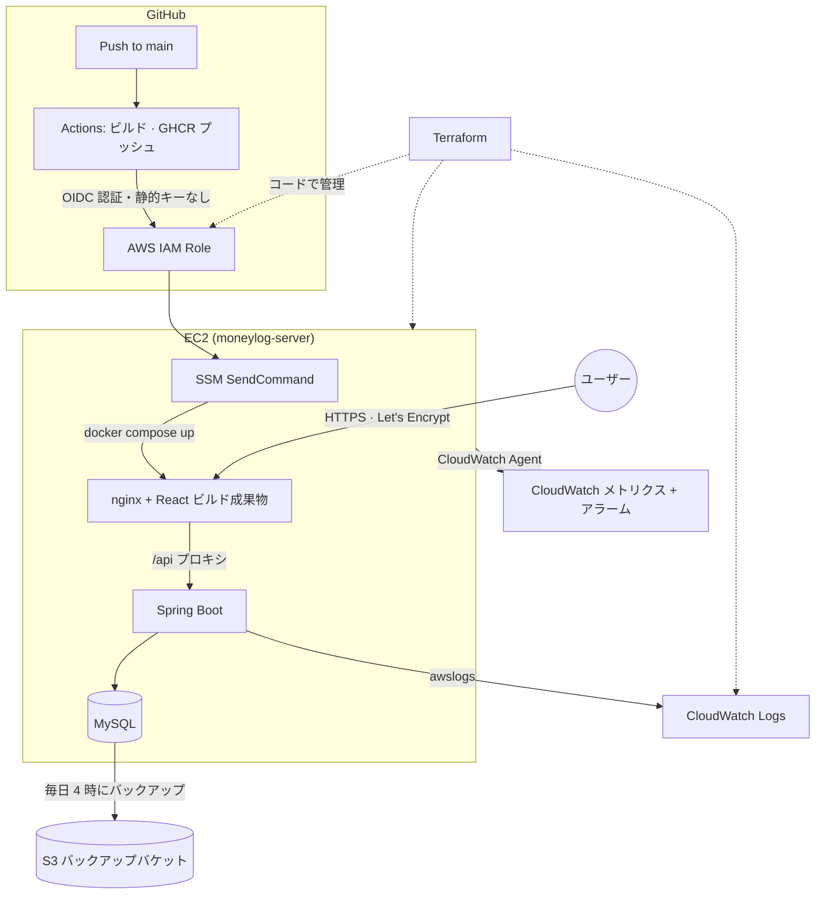

# マネーログ (MoneyLog)

[](https://github.com/DANIELSUNWOO/moneylog/actions/workflows/ci-backend.yml)      

[한국어](README.md) · **日本語**

ログインしたユーザーが収入・支出を記録し、カテゴリ別・月別の統計を確認する家計簿ウェブサービスです。アカウントごとに家計簿が分かれており、他の人の取引履歴は見られないようにしています。

- **デプロイ URL**: https://sunwoomoneylog.duckdns.org
- **デモアカウント**: `demo@example.com` / `demo1234`（登録なしでご覧いただけます）
- **API ドキュメント（Swagger）**: https://sunwoomoneylog.duckdns.org/swagger-ui.html
- **要件・設計ドキュメント**: [docs/requirements.md](docs/requirements.md) · [docs/erd.md](docs/erd.md) · [docs/api-spec.md](docs/api-spec.md)（`docs/` 配下の文書は韓国語です）

## 画面

**取引履歴**: 月・収入／支出・カテゴリで絞り込み、表示中の収入・支出の合計も表示します。


**月別統計**: その月の総収入・総支出・残高と、カテゴリ別の支出の割合を表示します。


## このプロジェクトを作った理由

日本でキャリアを始める前に資金を準備しておきたいと考え、お金を計画的に使うには、まず何にいくら使っているかを正確に把握する必要がありました。そこで、カテゴリ別の支出、月別の統計、その月の残高を一つの画面で確認できる家計簿を自分で作りました。

最初は自分だけで使うつもりでしたが、私のように留学や海外就職を準備している人にも役立つと思い、会員登録とログインを追加しました。アカウントごとに家計簿が分かれる構造になったため、他の人の取引履歴はどの経路からも見られないことを、最初に守るべきルールとして決めました。

開発は Claude と一緒に進めました。ブートキャンプで学んだ内容を、AI との対話でどこまで実装できるか確かめてみたかったからです。機能の構成や画面の配置は私が決め、実装やテスト用のダミーデータ作成のような繰り返しの作業は Claude に任せました。画面は飾るよりも記録に集中できるようシンプルにする方向で依頼し、完成した機能は自分で実際に動かして一つずつ確認しました。

## インフラで取り組んだこと

ブートキャンプで AWS、Docker、CI/CD まで学んだので、個人プロジェクトではデプロイまで最初から最後まで自分でやってみたいと考えました。デプロイしなければ他の人が使えないという理由もありました。

機能は自分の資金管理に十分なところまで作り、残りの時間はクラウド分野の経験に使いました。エンジニアとして働くようになったとき、フロントエンド、バックエンド、クラウド、データのどれを担当するかは前もって分からないので、時間のある大学生のうちにいろいろな分野を実際に経験しておこうと決めたからです。クラウドは事前知識がほとんどなかったため、資料を調べながら基本的な機能から一つずつ試しました。

| 領域 | やったこと | ドキュメント |
|---|---|---|
| 自動デプロイ | PR を出すと GitHub Actions でビルド・テスト（CI）、main にマージされると Docker イメージを作って EC2 にデプロイ（CD）。フロントエンドとバックエンドはワークフローを分け、変更した側だけをデプロイ | [cicd-pipeline-reference.md](docs/cicd-pipeline-reference.md) |
| HTTPS・ドメイン | Let's Encrypt の証明書を適用し、期限前に自動更新。IP が入った sslip.io のアドレスの代わりに自分の名前のアドレスを使いたくて、無料の DuckDNS に変更（サーバーが現在の IP を定期的に通知する仕組みのため、EC2 の再起動で IP が変わっても同じアドレスで接続できる） | [devops-roadmap.md](docs/devops-roadmap.md) |
| SSH なしのデプロイ | SSH キーでサーバーに接続していたデプロイを、実行のたびに AWS から一時的な権限を受け取る方式（OIDC）と SSM によるコマンド送信に変更し、22 番ポートを閉鎖 | [troubleshooting-oidc-ssm-deploy.md](docs/troubleshooting-oidc-ssm-deploy.md) |
| ロールバック | デプロイするイメージにコミット番号を付け、前のバージョンに戻してから再度上げる練習 | [rollback-drill.md](docs/rollback-drill.md) |
| バックアップ・復旧 | 毎日 DB を S3 にバックアップし、実際にテーブルを削除してから復旧する練習 | [backup-restore-drill.md](docs/backup-restore-drill.md) |
| モニタリング | CloudWatch でコンテナのログとメモリ・ディスク使用量を収集し、メモリが 85% を超えるとメールで通知 | [cloudwatch-setup.md](docs/cloudwatch-setup.md) |
| Terraform | コンソールで作った AWS リソースを Terraform のコードに移してみた。初めて使ったツールで、まだ慣れていない | [terraform-import.md](docs/terraform-import.md) |
| ブランチ運用 | main ブランチには PR と CI 通過を経てのみマージできるよう保護ルールを設定 | [branching-strategy.md](docs/branching-strategy.md) |
| エラー対応 | ドメイン変更後に会員登録ができなくなった CORS エラー、README のとおりにローカルで動かなかった三つの原因 | [troubleshooting-cors-signup.md](docs/troubleshooting-cors-signup.md) · [troubleshooting-local-docker-run.md](docs/troubleshooting-local-docker-run.md) |
| アクセス権限のテスト | 他の人の取引やカテゴリにアクセスすると拒否されるかを統合テスト 17 件で確認し、PR ごとに CI で実行 | [authorization/](backend/src/test/java/com/moneylog/backend/authorization) |

この中で一番長く詰まったのは、SSH なしのデプロイへの切り替えでした。公式ドキュメントどおりに設定したのに認証が 6 回続けて拒否され、設定値の入力ミスを疑って値をコードに直接書いても同じでした。設定をいくら変えても通らないので、推測をやめて、GitHub が実際に AWS に送っている値をログに出して確認することにしました。確認すると、リポジトリ名の後ろに数字の ID が付いた形式で、ドキュメントの例とは違っていました。この値に合わせるとすぐに通りました。次はデプロイのコマンドが失敗しましたが、SSM はコマンドを root 権限で実行する一方、docker compose が別のユーザーのフォルダにしかインストールされていなかったことが原因でした。

AWS は無料枠の範囲内だけで使うように構成し、実際の請求額は 0 円です。

## 技術スタック

| 領域 | 使用技術 |
|---|---|
| Backend | Java 21, Spring Boot 3.x, Spring Data JPA, Spring Security + JWT, Bean Validation, springdoc-openapi(Swagger), MySQL 8 |
| Frontend | React 19, Vite, react-router-dom, axios |
| Infra / DevOps | Docker（マルチステージビルド）, Docker Compose, GitHub Actions（OIDC 認証）, AWS（EC2 · S3 · CloudWatch · IAM · SSM）, Terraform, Let's Encrypt, DuckDNS, nginx |

## アーキテクチャ概要



AWS リソース（EC2・セキュリティグループ・IAM・S3・CloudWatch）は Terraform のコードで、デプロイの流れは GitHub Actions のワークフローファイルで定義しています。ただし、サーバー内の設定（証明書の自動更新、DuckDNS の IP 更新、DB バックアップスクリプト、`.env`）はまだ手作業で入れた状態のため、サーバーを作り直すとこの部分は再設定が必要です。

## 基本機能

会員登録・ログイン（JWT 認証）、カテゴリと取引履歴の CRUD、ページング・ソート、月別統計の照会を含む要件の全体は [docs/requirements.md](docs/requirements.md) に、API 仕様は [docs/api-spec.md](docs/api-spec.md) にまとめています（いずれも韓国語）。

## ローカルでの実行方法

```bash
git clone https://github.com/DANIELSUNWOO/moneylog.git
cd moneylog
cp .env.example .env   # DB_PASSWORD, JWT_SECRET などを設定（JWT_SECRET は openssl rand -base64 32 で生成）
docker compose up -d --build
```

- フロントエンド: http://localhost
- バックエンド Swagger: http://localhost:8080/swagger-ui.html
- MySQL（Workbench などの GUI クライアント接続用）: localhost:3307

`docker-compose.yml`（本番基準）に `docker-compose.override.yml`（ローカル専用のビルド・ポート設定）が自動的にマージされます。override ファイルは EC2 には配置しないため、ローカルでのみ必要な設定（イメージのビルド、8080/3307 ポートの公開）が本番のデプロイに混ざることはありません。

### コードを書きながら開発する場合

上の方法は本番の姿をそのまま再現できる代わりに、コードを一行直すたびにイメージを再ビルドする必要があります。開発中は DB だけをコンテナで動かし、残りは開発サーバーで起動するほうが速いです。

```bash
docker compose up -d mysql          # DB のみ
cd backend && ./gradlew bootRun     # バックエンド (localhost:8080)
cd frontend && npm run dev          # フロントエンド (localhost:5173)
```

Vite の開発サーバーが `/api` を `localhost:8080` にプロキシするため、この場合も CORS は発生しません。バックエンドはデフォルトプロファイルで `localhost:3307` の MySQL を参照しますが、これは上のコンテナが公開するポートです。

なお、二つの方法は 8080 番ポートを共有するため、同時には起動できません。

## 今後の予定

まずは初めて使った Terraform をきちんと理解し、上に書いたサーバー内の設定もコードに移して、サーバーを作り直しても手で入れ直すものがない状態にしたいと考えています。機能面では、予算設定、統計の可視化、CSV エクスポートを追加してみたいです。
