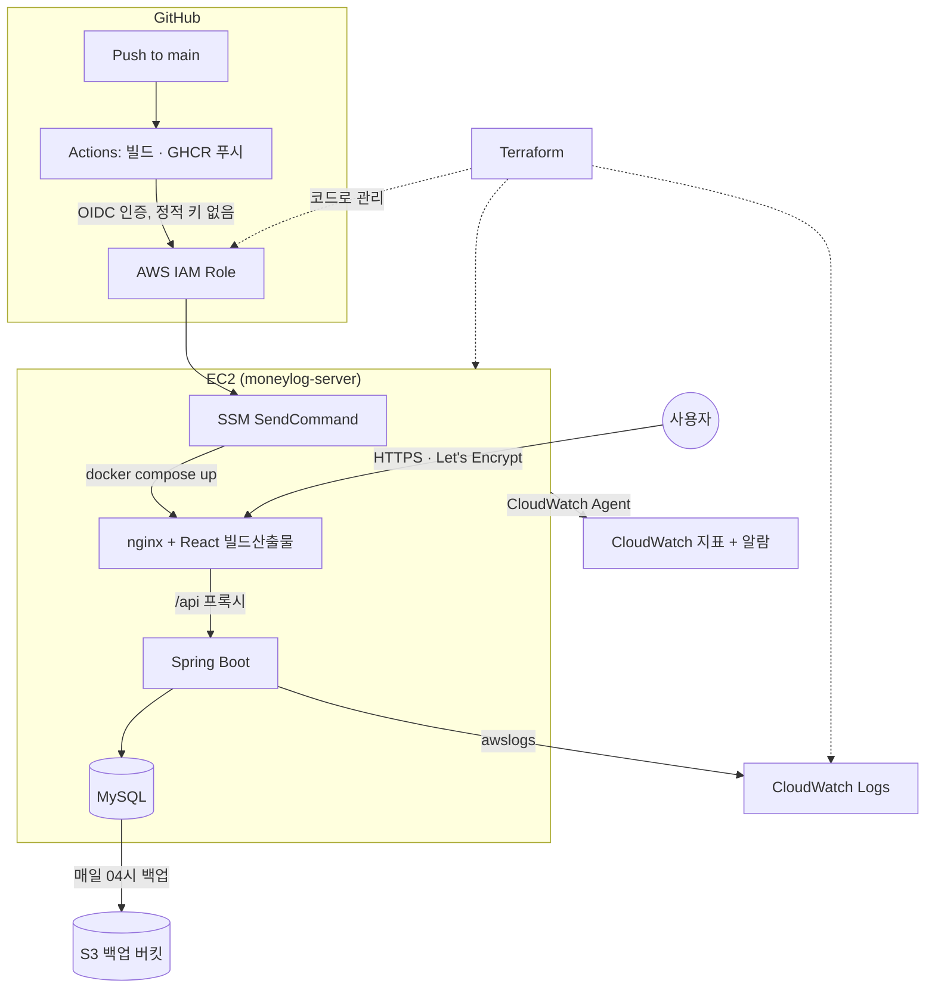

# 머니로그 (MoneyLog)

[](https://github.com/DANIELSUNWOO/moneylog/actions/workflows/ci-backend.yml)      

**한국어** · [日本語](README.ja.md)

로그인한 사용자가 수입·지출을 기록하고, 카테고리별·월별 통계를 확인하는 가계부 웹서비스입니다. 계정마다 가계부가 따로 쌓이며, 다른 사람의 거래 내역은 볼 수 없도록 만들었습니다.

- **배포 URL**: https://sunwoomoneylog.duckdns.org
- **데모 계정**: `demo@example.com` / `demo1234` (가입 없이 둘러볼 수 있습니다)
- **API 문서(Swagger)**: https://sunwoomoneylog.duckdns.org/swagger-ui.html
- **요구사항/설계 문서**: [docs/requirements.md](docs/requirements.md) · [docs/erd.md](docs/erd.md) · [docs/api-spec.md](docs/api-spec.md)

## 화면

**거래내역**: 월·수입/지출·카테고리로 걸러 보고, 조회한 페이지의 수입·지출 합계를 함께 보여줍니다.


**월별 통계**: 그달의 총수입·총지출·잔액과 카테고리별 지출 비중을 보여줍니다.


## 이 프로젝트를 만든 이유

일본에서 커리어를 시작하기 전에 자금을 미리 모아두고 싶었고, 돈을 계획적으로 쓰려면 어디에 얼마를 쓰는지부터 정확히 알아야 했습니다. 그래서 카테고리별 지출, 월별 통계, 그달의 잔액을 한 화면에서 볼 수 있는 가계부를 직접 만들었습니다.

처음에는 혼자 쓰려고 시작했지만, 저처럼 유학이나 해외 취업을 준비하는 사람에게도 쓸모가 있을 것 같아 회원가입과 로그인을 넣었습니다. 계정마다 가계부가 따로 쌓이는 구조가 되면서, 다른 사람의 거래 내역은 어떤 경로로도 볼 수 없어야 한다는 것을 가장 먼저 지켜야 할 규칙으로 정했습니다.

개발은 Claude와 함께 했습니다. 부트캠프에서 배운 내용을 AI와 대화하며 어디까지 구현할 수 있는지 확인해 보고 싶었기 때문입니다. 기능 구성과 화면 배치는 제가 정하고, 구현과 테스트용 더미 데이터 생성처럼 반복적인 작업은 Claude에게 맡겼습니다. 화면은 꾸미기보다 기록하는 데만 집중할 수 있도록 단순하게 만드는 방향으로 요청했고, 완성된 기능은 제가 직접 실행해 보며 하나씩 확인했습니다.

## 인프라에서 다룬 것들

부트캠프에서 AWS, Docker, CI/CD까지 배웠기 때문에, 개인 프로젝트에서는 배포까지 처음부터 끝까지 직접 해보고 싶었습니다. 배포를 해야 다른 사람도 쓸 수 있다는 점도 있었습니다.

기능은 제가 자금 관리를 하기에 충분한 수준까지 만든 뒤, 남은 시간은 클라우드 쪽을 경험하는 데 썼습니다. 앞으로 엔지니어로 일하게 되면 프론트엔드, 백엔드, 클라우드, 데이터 중 어떤 일을 맡게 될지 미리 알 수 없으니, 시간이 있는 대학생 때 여러 분야를 직접 해보자고 정했기 때문입니다. 클라우드는 사전 지식이 거의 없어서, 자료를 찾아가며 기본적인 기능부터 하나씩 적용해 봤습니다.

| 영역 | 한 일 | 문서 |
|---|---|---|
| 자동 배포 | PR을 올리면 GitHub Actions로 빌드·테스트(CI), main에 병합되면 Docker 이미지를 만들어 EC2에 배포(CD). 프론트엔드와 백엔드는 워크플로를 나눠 바뀐 쪽만 배포 | [cicd-pipeline-reference.md](docs/cicd-pipeline-reference.md) |
| HTTPS·도메인 | Let's Encrypt 인증서 적용, 만료 전 자동 갱신. IP가 들어간 sslip.io 주소 대신 제 이름으로 된 주소를 쓰려고 무료인 DuckDNS로 변경(서버가 현재 IP를 주기적으로 알려주는 방식이라, EC2 재시작으로 IP가 바뀌어도 같은 주소로 접속됨) | [devops-roadmap.md](docs/devops-roadmap.md) |
| SSH 없는 배포 | SSH 키로 서버에 접속하던 배포를, 실행할 때마다 AWS에서 임시 권한을 받는 방식(OIDC)과 SSM 명령 전송으로 변경하고 22번 포트를 닫음 | [troubleshooting-oidc-ssm-deploy.md](docs/troubleshooting-oidc-ssm-deploy.md) |
| 롤백 | 배포 이미지에 커밋 번호를 붙여, 이전 버전으로 되돌렸다가 다시 올려 보는 연습 | [rollback-drill.md](docs/rollback-drill.md) |
| 백업·복구 | 매일 DB를 S3에 백업하고, 실제로 테이블을 지운 뒤 복구해 보는 연습 | [backup-restore-drill.md](docs/backup-restore-drill.md) |
| 모니터링 | CloudWatch로 컨테이너 로그와 메모리·디스크 사용량 수집, 메모리 85% 초과 시 메일 알림 | [cloudwatch-setup.md](docs/cloudwatch-setup.md) |
| Terraform | 콘솔에서 만든 AWS 자원을 Terraform 코드로 옮겨 보기. 처음 써 본 도구라 아직 익숙하지 않음 | [terraform-import.md](docs/terraform-import.md) |
| 브랜치 운영 | main 브랜치에는 PR과 CI 통과를 거쳐서만 병합되도록 보호 규칙 설정 | [branching-strategy.md](docs/branching-strategy.md) |
| 오류 해결 | 도메인을 바꾼 뒤 회원가입이 막힌 CORS 오류, README대로 로컬 실행이 안 되던 원인 세 가지 | [troubleshooting-cors-signup.md](docs/troubleshooting-cors-signup.md) · [troubleshooting-local-docker-run.md](docs/troubleshooting-local-docker-run.md) |
| 접근 권한 테스트 | 다른 사람의 거래나 카테고리에 접근하면 거부되는지 통합 테스트 17개로 확인, PR마다 CI에서 실행 | [authorization/](backend/src/test/java/com/moneylog/backend/authorization) |

이 중 가장 오래 막혔던 건 SSH 없는 배포로 바꾸는 작업이었습니다. 공식 문서대로 설정했는데 인증이 6번 연속 거부됐고, 설정값 오타를 의심해 값을 코드에 직접 넣어 봐도 똑같았습니다. 설정을 아무리 바꿔도 안 되니, 추측을 그만두고 GitHub가 실제로 AWS에 보내는 값을 로그로 찍어 보기로 했습니다. 확인해 보니 저장소 이름 뒤에 숫자 ID가 붙은 형식이라 문서의 예시와 달랐고, 이 값에 맞추자 바로 통과했습니다. 그다음에는 배포 명령이 실패했는데, SSM은 명령을 root 권한으로 실행하는 반면 docker compose가 다른 사용자 폴더에만 설치되어 있던 것이 원인이었습니다.

AWS는 무료 범위 안에서만 쓰도록 구성해, 실제 청구 금액은 0원입니다.

## 기술 스택

| 영역 | 사용 기술 |
|---|---|
| Backend | Java 21, Spring Boot 3.x, Spring Data JPA, Spring Security + JWT, Bean Validation, springdoc-openapi(Swagger), MySQL 8 |
| Frontend | React 19, Vite, react-router-dom, axios |
| Infra / DevOps | Docker(멀티스테이지 빌드), Docker Compose, GitHub Actions(OIDC 인증), AWS(EC2 · S3 · CloudWatch · IAM · SSM), Terraform, Let's Encrypt, DuckDNS, nginx |

## 아키텍처 개요



AWS 자원(EC2·보안그룹·IAM·S3·CloudWatch)은 Terraform 코드로, 배포 과정은 GitHub Actions 워크플로 파일로 정의되어 있습니다. 다만 서버 안의 설정(인증서 자동 갱신, DuckDNS IP 갱신, DB 백업 스크립트, `.env`)은 아직 직접 손으로 넣은 상태라, 서버를 새로 만들면 이 부분은 다시 설정해야 합니다.

## 기본 기능

회원가입/로그인(JWT 인증), 카테고리·거래 내역 CRUD, 페이징·정렬, 월별 통계 조회를 포함한 전체 요구사항은 [docs/requirements.md](docs/requirements.md)에, API 명세는 [docs/api-spec.md](docs/api-spec.md)에 정리되어 있습니다.

## 실행 방법 (로컬)

```bash
git clone https://github.com/DANIELSUNWOO/moneylog.git
cd moneylog
cp .env.example .env   # DB_PASSWORD, JWT_SECRET 등을 채운다 (JWT_SECRET: openssl rand -base64 32)
docker compose up -d --build
```

- 프론트엔드: http://localhost
- 백엔드 Swagger: http://localhost:8080/swagger-ui.html
- MySQL(Workbench 등 GUI 클라이언트 연결용): localhost:3307

`docker-compose.yml`(운영 기준)에 `docker-compose.override.yml`(로컬 전용 빌드·포트 설정)이 자동으로 병합됩니다. override 파일은 EC2에 올라가지 않으므로, 로컬에서만 필요한 설정(이미지 빌드, 8080/3307 포트 노출)이 운영 배포에는 섞이지 않습니다.

### 코드를 고치며 개발할 때

위 방식은 배포된 모습을 그대로 재현하는 대신, 코드를 한 줄 고칠 때마다 이미지를 다시 빌드해야 합니다. 개발 중에는 DB만 컨테이너로 띄우고 나머지는 개발 서버로 돌리는 편이 빠릅니다.

```bash
docker compose up -d mysql          # DB만
cd backend && ./gradlew bootRun     # 백엔드 (localhost:8080)
cd frontend && npm run dev          # 프론트 (localhost:5173)
```

Vite 개발 서버가 `/api`를 `localhost:8080`으로 프록시하므로 이때도 CORS가 발생하지 않습니다. 백엔드는 기본 프로필에서 `localhost:3307`의 MySQL을 보는데, 이는 위 컨테이너가 여는 포트입니다.

두 방식은 8080 포트를 함께 쓰기 때문에 동시에 띄울 수 없습니다.

## 다음 계획

먼저 처음 써 본 Terraform을 제대로 이해하고, 위에 적은 서버 안의 설정도 코드로 옮겨 서버를 새로 만들어도 손으로 다시 넣을 것이 없게 하려고 합니다. 기능 쪽으로는 예산 설정, 통계 시각화, CSV 내보내기를 추가해 보고 싶습니다.
