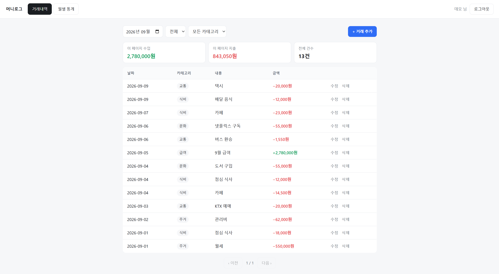
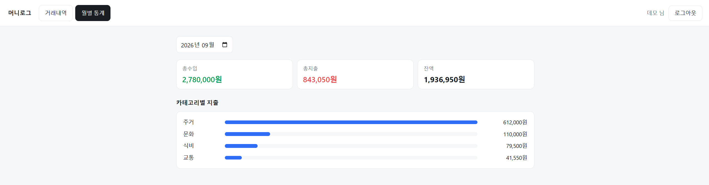
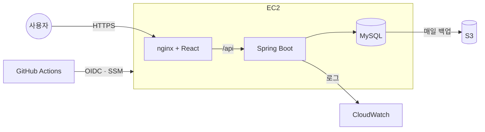

# 머니로그 (MoneyLog)

[](https://github.com/DANIELSUNWOO/moneylog/actions/workflows/ci-backend.yml)     

**한국어** · [日本語](README.ja.md)

수입·지출을 기록하고 카테고리별·월별 통계를 확인하는 가계부 웹서비스입니다.

**[서비스 바로가기](https://sunwoomoneylog.duckdns.org)** · 데모 계정 `demo@example.com` / `demo1234` · [API 문서](https://sunwoomoneylog.duckdns.org/swagger-ui.html)

| 거래내역 | 월별 통계 |
|---|---|
|  |  |

## 만든 이유

일본에서 커리어를 시작하기 전에 자금을 계획적으로 모으고 싶어서 만들었습니다. 어디에 얼마를 쓰는지, 이번 달 잔액이 얼마인지 한 화면에서 보는 것이 목표였습니다. 저처럼 유학이나 해외 취업을 준비하는 사람도 쓸 수 있도록 계정별로 가계부를 나누고, 다른 사람의 내역은 볼 수 없게 했습니다.

## 주요 기능

- 회원가입·로그인 (JWT)
- 수입·지출 등록, 수정, 삭제와 카테고리 관리
- 월·수입/지출·카테고리 필터와 페이징
- 월별 통계: 총수입, 총지출, 잔액, 카테고리별 지출 비중
- 다른 사용자의 데이터 접근 차단 (통합 테스트 17개로 확인)

## 기술 스택

| 영역 | 사용 기술 |
|---|---|
| Backend | Java 21, Spring Boot 3.x, Spring Data JPA, Spring Security, JWT, MySQL 8 |
| Frontend | React 19, Vite |
| Infra | Docker Compose, GitHub Actions, AWS (EC2, S3, CloudWatch, IAM, SSM), nginx, Let's Encrypt, Terraform |

## 구성도



## 배포와 운영에서 해본 것

기능을 완성한 뒤에는 부트캠프에서 배운 클라우드를 직접 적용해 보는 데 시간을 썼습니다. 클라우드는 사전 지식이 거의 없어서 기본 기능부터 하나씩 해봤습니다.

- **CI/CD**: PR에서 빌드·테스트, main 병합 시 EC2 자동 배포. 프론트·백엔드 워크플로 분리 ([문서](docs/cicd-pipeline-reference.md))
- **HTTPS·도메인**: Let's Encrypt 인증서와 자동 갱신, DuckDNS 도메인
- **SSH 없는 배포**: SSH 키 대신 OIDC로 임시 권한을 받아 SSM으로 배포, 22번 포트 닫음 ([트러블슈팅](docs/troubleshooting-oidc-ssm-deploy.md))
- **롤백·백업 연습**: 이전 버전으로 되돌리기, 테이블을 지우고 S3 백업에서 복구 ([롤백](docs/rollback-drill.md) · [백업](docs/backup-restore-drill.md))
- **모니터링**: CloudWatch 로그·메모리 지표 수집, 메모리 85% 초과 시 메일 알림 ([문서](docs/cloudwatch-setup.md))
- **Terraform**: 콘솔에서 만든 AWS 자원을 코드로 옮겨 봄. 처음 써 본 도구라 아직 익숙하지 않음 ([문서](docs/terraform-import.md))

AWS는 무료 범위 안에서만 사용해 실제 청구 금액은 0원입니다.

## 트러블슈팅

| 문제 | 원인과 해결 |
|---|---|
| OIDC 인증이 6번 연속 거부됨 | 공식 문서의 예시대로 설정했지만, GitHub가 실제로 보내는 값을 로그로 찍어 보니 저장소 이름 뒤에 숫자 ID가 붙은 형식이었음. 실제 값에 맞춰 해결 |
| SSM 배포 명령 실패 | SSM은 root로 명령을 실행하는데, docker compose가 ec2-user 폴더에만 설치되어 있었음. 공용 경로로 옮겨 해결 |
| 도메인 변경 후 회원가입 실패 | CORS 허용 목록에 새 도메인이 없었음 ([문서](docs/troubleshooting-cors-signup.md)) |
| README대로 로컬 실행이 안 됨 | 프록시·인증서·포트 충돌 세 가지 원인 ([문서](docs/troubleshooting-local-docker-run.md)) |

## 배운 점

- 설정을 계속 바꿔 보기보다, 실제로 오가는 값을 직접 확인하는 것이 원인을 찾는 가장 빠른 방법이었습니다.
- 자동화로 바꾸면 명령을 실행하는 사용자와 권한이 달라질 수 있다는 것을 배웠습니다.
- 백업은 만들어 두는 것만으로는 부족하고, 실제로 복구해 봐야 쓸 수 있는지 알 수 있었습니다.

## 한계와 다음 계획

- 서버 안의 설정(인증서 갱신, DuckDNS IP 갱신, DB 백업 스크립트)은 아직 직접 넣은 상태라, 서버를 새로 만들면 다시 설정해야 합니다.
- Terraform을 제대로 이해하고, 위 설정도 코드로 옮기려고 합니다.
- 예산 설정, 통계 그래프, CSV 내보내기를 추가해 보고 싶습니다.

## 로컬 실행

```bash
git clone https://github.com/DANIELSUNWOO/moneylog.git
cd moneylog
cp .env.example .env   # DB_PASSWORD, JWT_SECRET 등을 채운다
docker compose up -d --build
```

- 프론트엔드: http://localhost
- Swagger: http://localhost:8080/swagger-ui.html

요구사항, ERD, API 명세는 [docs](docs/) 폴더에 있습니다.
